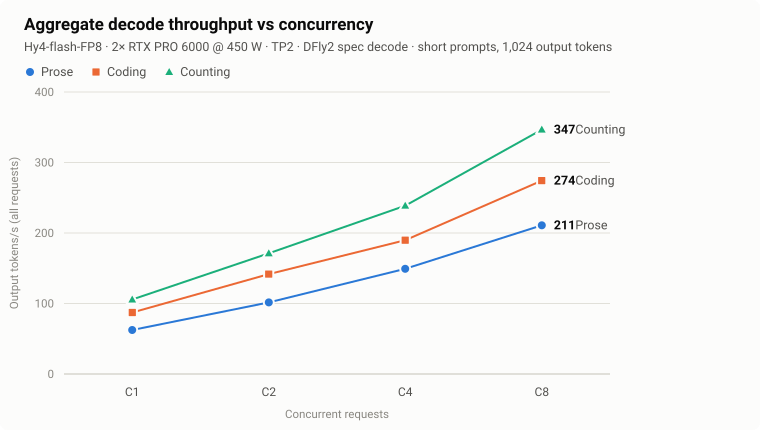
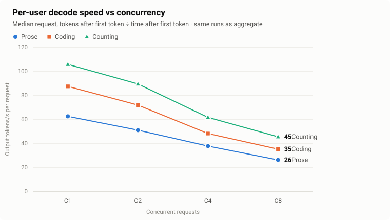
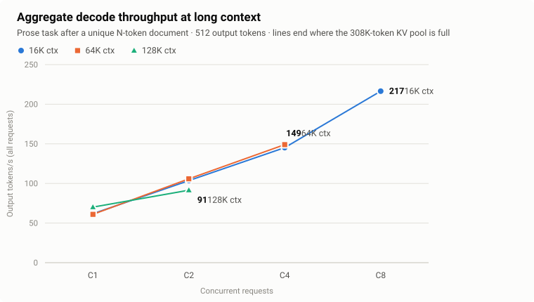

# HY-4-Flash-FP8 on 2× RTX PRO 6000 Blackwell

Serving [**tencent/Hy4-flash-FP8**](https://huggingface.co/tencent/Hy4-flash-FP8) (220B MoE, 512 experts / 16 active, sparse MLA + sliding-window attention, Engram n-gram memory, DFly2 speculative decoding) with vLLM on two **RTX PRO 6000 Blackwell Workstation** GPUs (SM120, 96 GB each, power-limited to **450 W**), tensor parallel 2, with a **256K context window**.

The stock `vllm/vllm-openai:hy4-flash` image refuses to run this model on SM120 (`NotImplementedError: Flash MLA requires Hopper or Blackwell data-center GPUs`). This repo has a three-file overlay patch that adds an SM120 path, the launch recipe, and measured speeds.

## TL;DR

| | |
|---|---|
| Prompt processing (warm, single request) | **~5,200–5,400 tok/s** from 4K to 128K tokens, ~4,950 tok/s at 249K |
| Decode, 1 user | **62 tok/s** prose · **87** coding · **106** counting |
| Decode, 8 users (aggregate) | **211 tok/s** prose · **274** coding · **347** counting |
| Decode, 1 user at 128K context | 70 tok/s (prose) |
| Context window | 262,144 tokens per request; KV pool 308,058 tokens |
| Time to first token, short prompt | 0.17–0.2 s |
| Power | 450 W cap per GPU; ~380–430 W average under load |

Decode numbers include DFly2 speculative decoding (5 draft tokens) and count reasoning tokens. Prompts are greedy (temperature 0).

## Hardware and software

| Component | Version |
|---|---|
| GPUs | 2× NVIDIA RTX PRO 6000 Blackwell Workstation Edition (SM120, 97,887 MiB each), PCIe, no NVLink |
| GPU power limit | **450 W each** (default and max is 600 W) |
| CPU / RAM | AMD Ryzen Threadripper PRO 9965WX (24C/48T), 256 GB RAM (`free` reports 215 GiB usable) |
| Driver / CUDA | 595.99.02 / CUDA 13.2 driver, CUDA 13.0 in the image |
| Image | `vllm/vllm-openai:hy4-flash` = `sha256:6b645bfbf4b89602d38f6e93c1c418516ec0bfbf54b64cd661b8075bfec01da1` |
| vLLM / FlashInfer / PyTorch | 0.1.dev25463+g77766db1f / 0.7.4 / 2.14.0+cu130 |
| Model | [`tencent/Hy4-flash-FP8`](https://huggingface.co/tencent/Hy4-flash-FP8) @ `bd0e136e89a9ecd5ea17668cd89cf54fa127e795` |
| OS | Linux 7.0.0 (Ubuntu) |

## What's where: VRAM, RAM, and the context pool

**Per GPU (VRAM, 95.6 GiB usable, capped at 90.2 GiB by `--gpu-memory-utilization 0.95`):**

| Item | Size per GPU |
|---|---|
| Model weights (FP8 routed experts, BF16 dense/attention/shared experts, BF16 LM head, DFly2 drafter, vision tower), sharded TP2 | **80.8 GiB** |
| KV cache pool | **5.64 GiB → 308,058 tokens** |
| CUDA graphs | ~0.36 GiB |
| Encoder (image) cache | 0.05 GiB, taken from the KV pool |
| Total in use (`nvidia-smi`) | ~90.5 GiB |

**Host RAM:** the four **Engram n-gram tables** (layers 2/12/22/32, ~165M rows × 96 each) are kept in **pinned host memory** and read by the GPUs over PCIe via UVA. This is vLLM's default for this model (`EngramConfig.cpu_offload=True`). The checkpoint stores them in BF16, and vLLM keeps them in BF16: about **118 GiB pinned** in total, half per TP rank. That's why the FP8 checkpoint (268 GB) fits on 2× 96 GB at all. Leave at least ~130 GB of RAM free for the server.

| Weight class | Size in checkpoint | Lives in |
|---|---|---|
| Routed experts (FP8 128×128 blocks) | 138.4 GiB | VRAM (TP2) |
| Engram tables (BF16) | 118.2 GiB | Pinned host RAM |
| Everything else (attention, shared experts, embeddings, vision) | 9.9 GiB | VRAM |
| DFly2 drafter | 0.9 GiB | VRAM |

**Context pool:** the KV cache uses the packed `fp8_ds_mla` layout, the only layout the SM120 sparse-MLA kernel reads. Each token costs only about 19 KB per GPU, because 30 of the 42 layers are sliding-window (512 tokens) and only the 12 sparse-attention layers grow with the sequence. With `--max-model-len 262144` the pool holds 1.18 full-length requests at once. You can mix freely as long as the total stays under ~308K tokens, for example 2 × 128K, 4 × 64K, or 8 × 16K-plus. vLLM rejected `--max-model-len 500000` on this box; it estimated the ceiling at **~286K** tokens with `--max-num-seqs 8`.

## Recipe

### 1. Download the model

```bash
huggingface-cli download tencent/Hy4-flash-FP8 --revision bd0e136e89a9ecd5ea17668cd89cf54fa127e795
docker pull vllm/vllm-openai:hy4-flash
```

### 2. Run it

```bash
git clone https://github.com/hyudryu/HY-4-Flash-FP8-2xRTXPro6000
cd HY-4-Flash-FP8-2xRTXPro6000
./recipe/run.sh            # extra vLLM flags can be appended
docker logs -f hy4-flash-fp8
```

[`recipe/run.sh`](recipe/run.sh) bind-mounts the three patch files read-only over the image and runs:

```bash
vllm serve tencent/Hy4-flash-FP8 --revision bd0e136e89a9ecd5ea17668cd89cf54fa127e795 \
  --served-model-name hy4-flash --tensor-parallel-size 2 --dtype bfloat16 \
  --gpu-memory-utilization 0.95 --max-model-len 262144 --max-num-seqs 8 \
  --max-num-batched-tokens 8192 --limit-mm-per-prompt '{"image":1,"video":0}' \
  --speculative-config '{"num_speculative_tokens":5,"method":"dfly"}' \
  --enable-auto-tool-choice --reasoning-parser hy_v4 --tool-call-parser hy_v4 \
  --enable-prompt-tokens-details
# env: HF_HUB_OFFLINE=1 VLLM_USE_RUST_FRONTEND=1
```

Weights load in ~3 minutes, and the server answers after ~8–9 minutes, which includes warmup and CUDA-graph capture. Test it:

```bash
curl -s localhost:8000/v1/chat/completions -H 'Content-Type: application/json' \
  -d '{"model":"hy4-flash","messages":[{"role":"user","content":"What is 17*23?"}]}'
```

**Do not pass:**
- `--attention-backend FLASHMLA_SPARSE`. FlashMLA has no SM120 kernels, and that flag was the original crash.
- `--kv-cache-dtype fp8`. Leave it at `auto`; it becomes `fp8_ds_mla` automatically.

### Optional: running under a manager (SparkDeck, etc.)

If your launcher supports read-only file mounts, use the same three mounts with the same flags. In SparkDeck, set `runtime_file_mounts` on the deployment:

```json
[
  {"source": "/path/to/repo/patch/vllm/models/hy_v4_flash/nvidia/sm120.py",
   "target": "/usr/local/lib/python3.12/dist-packages/vllm/models/hy_v4_flash/nvidia/sm120.py"},
  {"source": "/path/to/repo/patch/vllm/models/hy_v4_flash/nvidia/attention.py",
   "target": "/usr/local/lib/python3.12/dist-packages/vllm/models/hy_v4_flash/nvidia/attention.py"},
  {"source": "/path/to/repo/patch/vllm/models/hy_v4/nvidia/attention.py",
   "target": "/usr/local/lib/python3.12/dist-packages/vllm/models/hy_v4/nvidia/attention.py"}
]
```

## The SM120 patch

Files are in [`patch/`](patch/), and diffs against the image are in [`patch/diffs/`](patch/diffs/). It follows the same approach as upstream draft PR [vllm#68387](https://github.com/vllm-project/vllm/pull/68387) for issue [vllm#68380](https://github.com/vllm-project/vllm/issues/68380):

1. **`hy_v4_flash/nvidia/sm120.py` (new):** `FlashSM120Impl` / `FlashSM120SparseBackend` / `FlashSM120SWABackend` subclass vLLM's `FLASHINFER_MLA_SPARSE_SM120` backend.
   - They pass Hy4's per-head **learnable attention sink** to FlashInfer's SM120 sparse-MLA kernel (`sinks=`). The stock backend silently drops it.
   - They read the `fp8_ds_mla` tile scales as `arbitrary_fp32`, not the default `pow2_fp32`. Against the bytes vLLM actually writes, `pow2_fp32` gave about 3× the attention error; see [vllm#54563](https://github.com/vllm-project/vllm/pull/54563).
2. **`hy_v4_flash/nvidia/attention.py`:**
   - Accepts compute capability 12.x and picks the SM120 backends there.
   - For the 30 sliding-window layers, it sets the window after constructing `MLAAttention`. This sidesteps the generic "sliding-window MLA does not support fp8_ds_mla" guard; compare [vllm#68365](https://github.com/vllm-project/vllm/pull/68365). The window itself is enforced by Hy4's `FlashWindowIndexer` through the top-k indices.
3. **`hy_v4/nvidia/attention.py`:** gives the **DFly2 drafter** the same sink-capable SM120 backend, so the drafter doesn't run without its sink.

Behavior on Hopper and Blackwell data-center GPUs (SM90/SM100) is unchanged. Once upstream merges SM120 support, drop the mounts.

### Accuracy notes

- SM120 kernel checks against PyTorch references:
  - DeepGEMM paged MQA logits (the compressed indexer) match to ~2e-7 relative.
  - Sparse MLA with sinks matches to ~3% relative (max over tokens). The sink handling is exact: errors are the same with and without a sink, while the sink itself moves the output by ~50%.
- **The KV cache is FP8 (`fp8_ds_mla`), and the SM120 kernel also does its attention math in FP8** (Q and P). On SM120 there is no BF16-KV sparse-MLA kernel. Expect small deviations from an H100/B200 run of the same checkpoint. Weights are used exactly as shipped, including the BF16 LM head.
- Smoke tests:
  - 17×23 = 391; capital of Australia = Canberra.
  - A correct palindrome function, with no repetition loops in the reasoning.
  - Exact recall of a code planted at the start of a 4,850-token prompt.

## Benchmarks

Method ([`bench/bench.py`](bench/bench.py), stdlib only, streaming OpenAI API):
- Every prompt is unique, so the prefix cache never helps.
- Sampling is greedy, and token counts come from the server's own usage stats.
- Decode tok/s is measured only while every request in the batch is decoding, so prefills are excluded. "Per user" is the median request's tokens after its first token divided by time after its first token.
- Raw results and a 1 Hz GPU power log are in [`bench/`](bench/).

### Prompt processing (prefill), single request, warm

| Prompt tokens | Time to first token (s) | Prefill tok/s |
|---|---|---|
| 1,035 | 0.27 | 3,777 |
| 4,074 | 0.78 | 5,236 |
| 16,397 | 3.15 | 5,198 |
| 32,629 | 6.07 | 5,372 |
| 65,346 | 12.27 | 5,324 |
| 130,622 | 25.10 | 5,205 |
| 248,860 | 50.31 | 4,947 |

Mean of two warm runs, which agreed within 2%. **The first long prompts after a server start are slower** (16K took 7.6 s cold versus 3.2 s warm) while Triton kernels JIT-compile; see `results-prefill-cold.json`.

### Decode at concurrency 1 / 2 / 4 / 8 (short prompts, 1,024 output tokens)

<picture>
  <source media="(prefers-color-scheme: dark)" srcset="docs/charts/decode-aggregate-dark.svg">
  
</picture>

<picture>
  <source media="(prefers-color-scheme: dark)" srcset="docs/charts/decode-per-user-dark.svg">
  
</picture>

| Workload | C | Aggregate tok/s | Per-user tok/s | TTFT p50 (s) |
|---|---|---|---|---|
| Prose (short story) | 1 | 62.4 | 62.4 | 0.17 |
| | 2 | 101.6 | 50.9 | 0.60 |
| | 4 | 149.3 | 37.7 | 0.91 |
| | 8 | 210.9 | 26.1 | 0.86 |
| Coding (Python + tests) | 1 | 87.3 | 87.3 | 0.20 |
| | 2 | 141.7 | 71.8 | 0.26 |
| | 4 | 189.8 | 48.1 | 0.25 |
| | 8 | 274.3 | 35.1 | 0.42 |
| Counting (1…400 in words) | 1 | 105.6 | 105.6 | 0.18 |
| | 2 | 171.2 | 89.3 | 0.18 |
| | 4 | 238.8 | 61.6 | 0.41 |
| | 8 | 346.7 | 45.4 | 0.56 |

Medians of 2 rounds per cell. The spread across workloads comes from DFly2 speculative decoding: predictable text (counting, code) gets more draft tokens accepted than free-form prose.

### Decode at long context (prose task after a unique N-token document, 512 output tokens)

<picture>
  <source media="(prefers-color-scheme: dark)" srcset="docs/charts/decode-context-dark.svg">
  
</picture>

| Context | C | Aggregate decode tok/s | Per-user tok/s | TTFT p50 (s) |
|---|---|---|---|---|
| 16K | 1 | 61.8 | 61.8 | 3.8 |
| 16K | 2 | 103.6 | 45.6 | 4.6 |
| 16K | 4 | 145.2 | 27.7 | 7.7 |
| 16K | 8 | 216.5 | 19.1 | 14.7 |
| 64K | 1 | 61.0 | 61.0 | 12.4 |
| 64K | 2 | 105.9 | 38.8 | 18.6 |
| 64K | 4 | 149.0 | 16.6 | 31.1 |
| 64K | 8 | — | — | — (needs ~530K KV tokens > 308K pool) |
| 128K | 1 | 70.1 | 70.1 | 25.2 |
| 128K | 2 | 91.5 | 31.3 | 38.1 |
| 128K | 4 / 8 | — | — | — (exceeds pool) |

Thanks to sparse attention, single-user decode speed doesn't degrade with context: about 61–70 tok/s from 16K to 128K. Aggregate decode at a given C matches the short-context numbers. Per-user tok/s at C≥2 is lower than the aggregate suggests, because each request's decode overlaps the other requests' prefills. TTFT at higher concurrency is dominated by queued prefills of the other requests.

### Power (450 W limit per GPU, 1 Hz `nvidia-smi` samples)

| Phase | GPU 0 avg / max | GPU 1 avg / max | Peak temp (GPU 0 / 1) |
|---|---|---|---|
| Prefill sweep (warm) | 427 / 451 W | 427 / 445 W | 69 / 82 °C |
| Decode, C1–C8 | 381 / 440 W | 390 / 450 W | 65 / 79 °C |
| Long-context decode | 411 / 439 W | 416 / 442 W | 69 / 81 °C |

Idle is about 19–24 W per GPU with the model loaded. GPU 1 is the top card and runs about 12 °C hotter. Median SM clocks under load were 2.65–2.82 GHz.

### Reproduce

```bash
cd bench
python3 bench.py --only prefill  --out results-prefill.json
python3 bench.py --only decode   --out results-decode.json
python3 bench.py --only context  --pool-tokens 308058 --out results-context.json
# or ./run_all.sh  (all three phases, plus a GPU power log)
python3 make_charts.py   # regenerates docs/charts/*.svg from the JSON results
```

## Known limitations

- **Upstream support is not merged yet**. Track [vllm#68380](https://github.com/vllm-project/vllm/issues/68380) and [vllm#68387](https://github.com/vllm-project/vllm/pull/68387).
- **FP8 KV cache and FP8 attention math** are mandatory on SM120 with this image (see accuracy notes).
- **The context ceiling is ~286K tokens** with this memory split. Raising it means freeing VRAM: lower `--max-num-seqs`, or raise `--gpu-memory-utilization` toward 0.97.
- **Startup warnings, all benign:**
  - No FlashInfer SM120 autotune cache, so the kernels run with default tuning.
  - The CUDA-graph mode falls back from `FULL_AND_PIECEWISE`.
  - The DFly drafter ignores image embeddings, so speculation helps less on image prompts.
- **Two copies won't fit.** The model needs about 81 GiB per GPU plus ~118 GiB of pinned host RAM.
